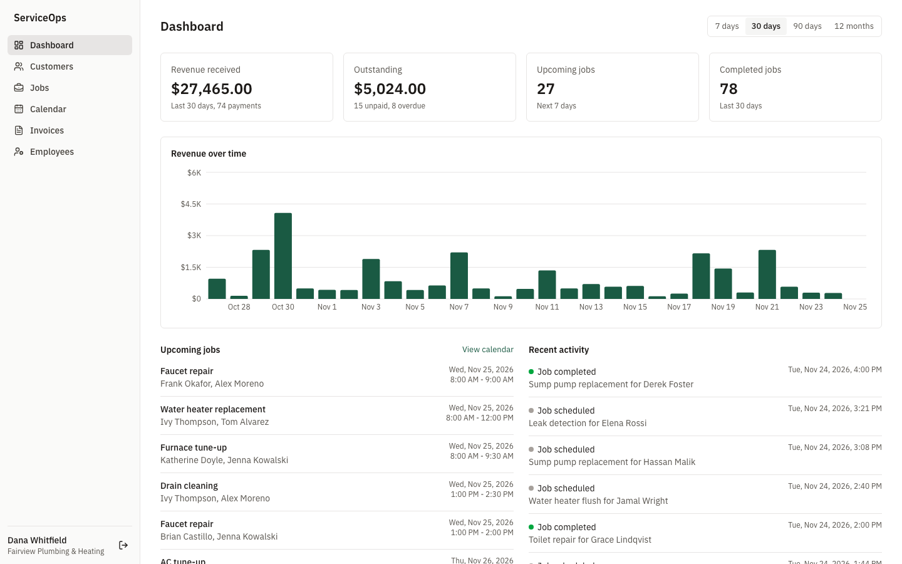
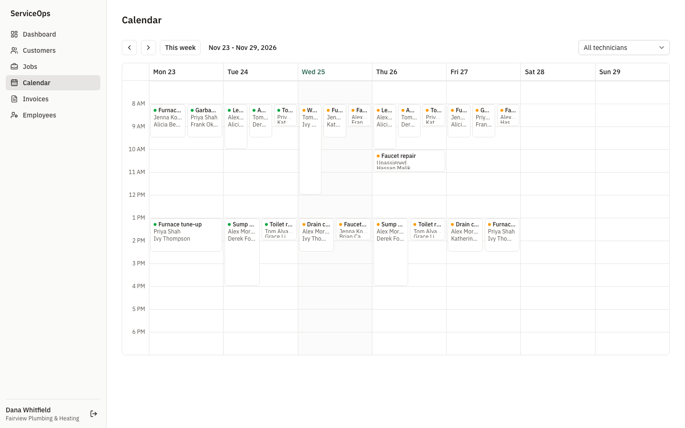
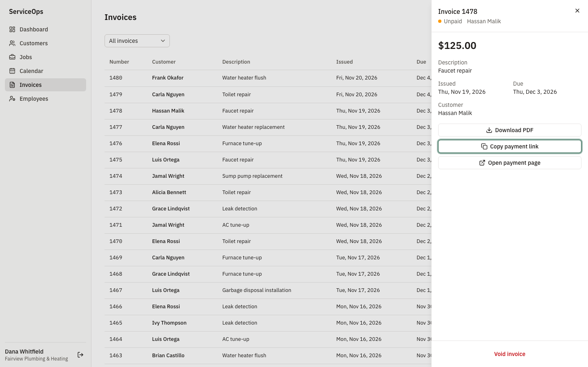
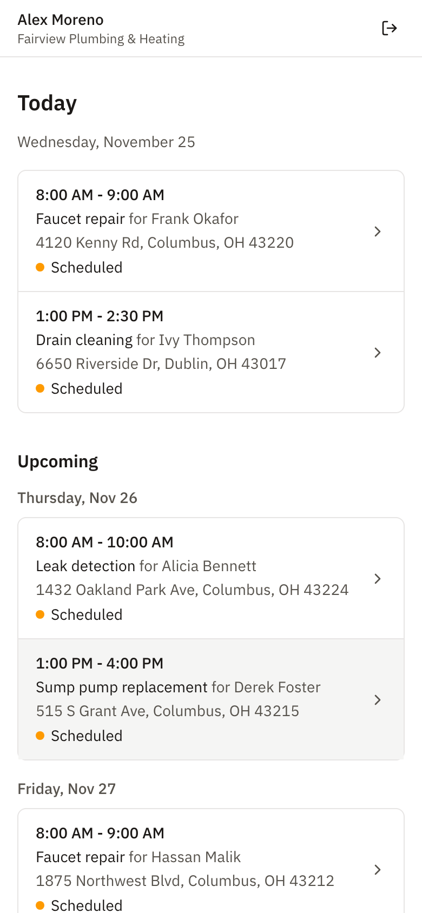
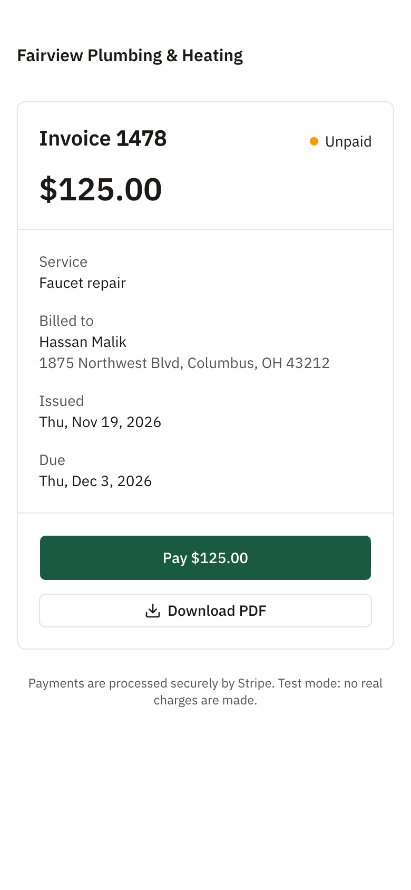

# ServiceOps

Scheduling, invoicing, and payments for small field-service businesses: customers, jobs, technician assignments, invoices, and Stripe payments in one application.

Live demo: _link added once deployed_. No sign-up required: choose "Explore as administrator" or "Explore as technician". Demo data resets hourly.



| Week calendar | Invoice detail |
|---|---|
|  |  |

| Technician workspace (phone) | Public payment page (phone) |
|---|---|
|  |  |

## What it demonstrates

- **Scheduling conflicts prevented in the database.** A Postgres exclusion constraint rejects overlapping jobs for the same technician, including concurrent requests.
- **Authorization enforced below the UI.** Row-Level Security isolates organizations and separates administrator and technician access. Composite foreign keys make cross-organization references impossible.
- **Correct payment handling.** Stripe webhooks are signature-verified, processed idempotently, and checked against the invoice amount and currency before an invoice is marked paid. The checkout redirect never changes state.
- **Immutable invoices.** Amounts are copied at issue and protected by a trigger; editing the job afterwards does not change the invoice.
- **Tests for the cases that matter.** Permissions, isolation, scheduling, duplicate invoices, duplicate and failed webhooks, dashboard figures, the full customer-to-payment workflow, and automated accessibility checks on every page.

## Features

- Customer records with search and job and invoice history
- Job scheduling with list and week calendar views, rescheduling, and status tracking
- Mobile-first technician workspace for today's and upcoming jobs
- Invoice generation, PDF download, and a public payment page using Stripe Checkout
- Dashboard with revenue, outstanding invoices, job counts, revenue over time, and recent activity

## Demo walkthrough

1. Sign in as administrator. Create a customer.
2. Schedule a job and assign a technician.
3. Sign in as technician. Start and complete the job.
4. Sign in as administrator. Generate the invoice and open its payment link.
5. Pay with test card `4242 4242 4242 4242`, any future expiry, any CVC.
6. Return to the dashboard to see the payment in revenue and the invoice marked paid.

## Architecture

A single Next.js application on Vercel with Supabase for Postgres and Auth. Server Components read with the user's session so RLS applies; Server Actions validate with Zod and write through the same session. Invariants that must hold under concurrency live in Postgres as constraints, triggers, and transactional functions. The service-role key is used only by the Stripe webhook and the demo reset endpoint.

This demo runs a single fictional merchant on one Stripe test account. Accepting payments on behalf of independent businesses would require Stripe Connect.

## Engineering decisions

**Rules that must hold under concurrency live in Postgres.** Two administrators can book the same technician at the same moment, and Stripe can deliver the same event twice in parallel. Application checks cannot see each other's uncommitted work, so the guarantees are database objects: an exclusion constraint on technician time ranges, a partial unique index allowing one active invoice per job, triggers that enforce status transitions and freeze invoice amounts, and transactional functions for invoice numbering and payment recording. The application maps the resulting SQLSTATE codes to field-level messages, such as which job a new booking collides with. Tests fire the conflicting requests concurrently to prove it.

**The webhook is the only thing that marks an invoice paid.** The Checkout success redirect only shows "processing". The webhook verifies the signature on the raw body, then a single transaction records the Stripe event id (so a redelivery is a no-op), locks the invoice, and checks that it is unpaid and that amount and currency match before inserting the payment. Mismatches and unpaid sessions are recorded and logged rather than retried forever. Checkout sessions are created from the stored invoice amount with an idempotency key, so repeated clicks reuse one session, and the server refuses any Stripe key that is not a test key.

**Authorization does not depend on the UI.** Every read and write goes through the signed-in user's session, so Row-Level Security applies everywhere. Column-level grants stop clients from writing identifiers, roles, or lifecycle timestamps, and composite foreign keys on `(organization_id, id)` make a cross-organization reference impossible even for a buggy query. The service-role key appears in exactly two server-only modules: the Stripe webhook and the demo reset.

**Money and time are stored once and interpreted at the edges.** Amounts are integer cents. Timestamps are `timestamptz`; "today", calendar weeks, overdue status, and dashboard buckets are computed in the organization's time zone, including across daylight saving changes. Dashboard aggregates run in SQL and are tested against figures recomputed independently from the raw rows.

**A public demo has to survive its visitors.** Demo data is generated arithmetically relative to the reset time, so it always looks current and its figures are reproducible. An hourly job calls a bearer-protected endpoint that restores the demo logins' passwords (a visitor can change them through the Auth API) and regenerates the data. Per-organization row caps are enforced by a statement-level trigger that takes an advisory lock, so parallel inserts cannot slip past the limit.

**Tests target behavior with real consequences.** Database tests sign in as seeded users and go through RLS exactly as the app does. Webhook tests sign payloads with Stripe's test helper and call the route handler. Playwright covers permissions, scheduling conflicts, the technician flow on a phone-sized screen, the full customer-to-payment workflow (ending with a signed webhook instead of the hosted Checkout page, which keeps CI deterministic), and axe accessibility checks plus a no-horizontal-scroll check on every page at desktop and phone widths.

**Deliberately out of scope.** Stripe Connect (this is one fictional merchant on one test account), refunds, partial payments, email, and sign-up. Each would be a real feature with its own failure modes, not a checkbox.

## Local setup

Requirements: Node 22, pnpm, Docker, Supabase CLI, Stripe CLI.

```
pnpm install
cp .env.example .env.local
pnpm db:start
pnpm db:reset
pnpm dev
```

In a second terminal, forward webhooks and copy the printed signing secret into `STRIPE_WEBHOOK_SECRET`:

```
stripe listen --events checkout.session.completed,checkout.session.async_payment_succeeded,checkout.session.async_payment_failed --forward-to localhost:3000/api/stripe/webhook
```

### Environment variables

| Variable | Purpose |
|---|---|
| `NEXT_PUBLIC_APP_URL` | Base URL for payment links and Checkout redirects |
| `NEXT_PUBLIC_SUPABASE_URL` | Supabase project URL |
| `NEXT_PUBLIC_SUPABASE_ANON_KEY` | Supabase public key |
| `SUPABASE_SERVICE_ROLE_KEY` | Server only: webhook and demo reset |
| `STRIPE_SECRET_KEY` | Stripe test secret key |
| `STRIPE_WEBHOOK_SECRET` | Webhook signing secret |
| `DEMO_ADMIN_EMAIL`, `DEMO_ADMIN_PASSWORD` | Demo administrator credentials |
| `DEMO_TECHNICIAN_EMAIL`, `DEMO_TECHNICIAN_PASSWORD` | Demo technician credentials |
| `DEMO_RESET_SECRET` | Bearer token for the reset endpoint |

## Tests

```
pnpm lint && pnpm typecheck
pnpm test        # unit, database, and webhook tests against local Supabase
pnpm test:e2e    # Playwright
```

CI runs all of the above on every push, plus a check that generated database types match the migrations.

## Deployment

- **Supabase:** a hosted project with the migrations applied (`supabase link`, then `supabase db push`). Keep "Allow new users to sign up" off and "Secure email change" on. The demo users are created by the first reset, not by `seed.sql`.
- **Vercel:** the environment variables above, with `NEXT_PUBLIC_APP_URL` set to the deployed URL and long random values for the demo passwords and `DEMO_RESET_SECRET`.
- **Stripe:** a test-mode webhook endpoint at `<deployed URL>/api/stripe/webhook` for the three `checkout.session` events; its signing secret goes in `STRIPE_WEBHOOK_SECRET`.
- **GitHub:** the `DEMO_URL` repository variable and the `DEMO_RESET_SECRET` secret enable the hourly reset workflow.

